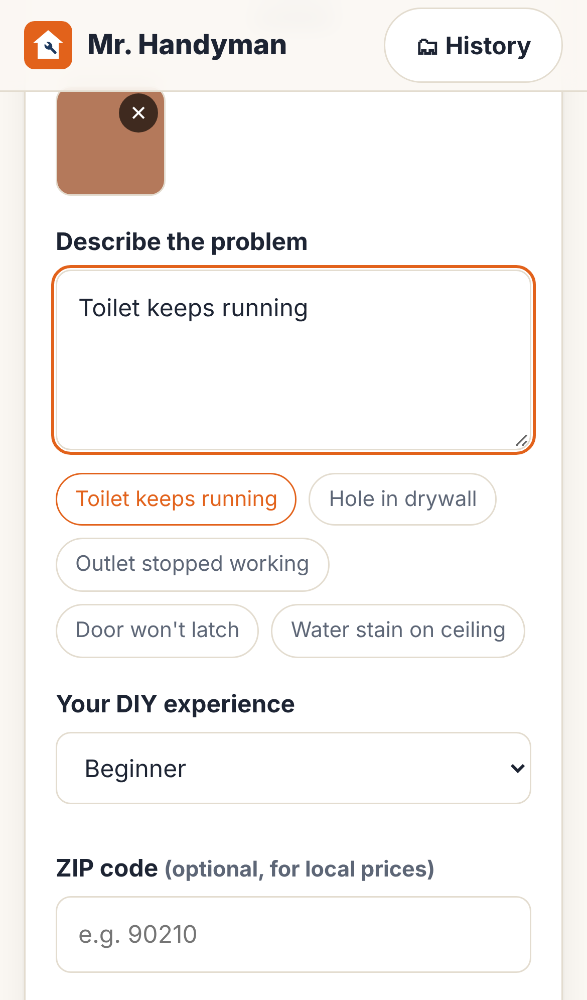

# 🔧 Mr. Handyman: AI Home Repair (MVP)

Snap a photo of a home repair problem and describe it. The AI gives you:

- **A diagnosis**: what's most likely wrong, other possible causes, and a confidence level
- **An honest verdict**: Easy DIY / Moderate / Advanced / Call a pro / 🚨 Emergency
- **A line-by-line budget**: every material and tool with a price range and where to buy it, plus the **DIY total next to the price a pro would charge**
- **Step-by-step instructions** for your skill level, with a safety note and pro tip on each step, and checkboxes
- **Alternatives**: handyman vs. licensed trade, repair vs. replace, warranty, and so on
- **A ready-to-send message for a contractor** and the questions to ask before hiring

One Node server provides all three pieces:

| Piece | URL | What it is |
|---|---|---|
| **Website** | `/` | Marketing landing page: how it works, features, pricing, FAQ |
| **App** | `/app` | Mobile-first web app. It installs to the phone's home screen like a native app (PWA) |
| **API** | `POST /api/diagnose` | Takes up to 4 photos plus a description, calls Claude, and returns a structured repair report |

Market and competitor research: [`research/COMPETITIVE_RESEARCH.md`](research/COMPETITIVE_RESEARCH.md)



## Run it

```bash
cd mr-handyman
npm install
```

```bash
ANTHROPIC_API_KEY=sk-ant-... npm start
```

Open http://localhost:3000. Without an API key it runs in **demo mode** and returns a sample report, so you can click through the whole app.

To try it on your phone, open `http://<your-computer's-LAN-IP>:3000/app`. For "Add to Home Screen" install, deploy it somewhere with HTTPS (Render, Railway, Fly.io and similar all work: set `ANTHROPIC_API_KEY` and run `npm start`).

### Settings (environment variables)

| Variable | Default | Purpose |
|---|---|---|
| `ANTHROPIC_API_KEY` | none | Claude API key. Without it the app runs in demo mode |
| `MRH_MODEL` | `claude-opus-5-5` | Claude model to use |
| `PORT` | `3000` | Server port |
| `DEMO_MODE` | none | Set to `1` to force sample reports |

## How it works

- `server.js`: Express server. It receives photos (max 4, 5 MB each, JPEG/PNG/WebP/GIF) and sends them to Claude with **structured outputs**, so the response always matches the report schema. If the model declines a request, server-side fallback retries it on another model. The system prompt is prompt-cached.
- `lib/schema.js`: the report format (diagnosis, verdict, budget lines, steps, alternatives, contractor message…).
- `lib/prompt.js`: the "seasoned contractor" instructions, including **hard safety rules**. Gas, panel work, structural, roofing at height, asbestos/lead and large mold areas always go to a pro; emergencies get do-this-now instructions.
- `public/`: website + app in plain HTML/CSS/JS (no build step). Photos are shrunk on the phone before upload. Repair history is saved **only on the user's device**.

**Cost per diagnosis:** roughly $0.05–0.15 on the default model (estimated, not measured), depending on photo count and report length. To cut cost, set `MRH_MODEL` to a cheaper Claude model.

## What's not in the MVP yet

- **Accounts and billing**: the Free (3/month) and Pro ($4.99/month) tiers on the website aren't enforced yet. Add auth + Stripe.
- **Rate limiting**: add it before a public launch so nobody can run up your API bill.
- **Follow-up chat**, shopping links, a "find a local pro" handoff, video/sound diagnosis. See the roadmap in the research doc.
- **App Store / Play Store builds**: wrap `/app` with Capacitor when ready. The PWA already works on phones.

## ⚠️ Before you launch: the name

"Mr. Handyman" is a **registered trademark of Mr. Handyman LLC (Neighborly)**, a national handyman franchise. Get legal advice before launching publicly under this name. To rebrand, search for `Mr. Handyman` in `public/` and `lib/prompt.js`, and update `public/manifest.webmanifest`.

## Disclaimer

The AI-generated guidance is for information only. It doesn't replace an in-person inspection by a licensed professional. Users should follow local codes and permit requirements.
